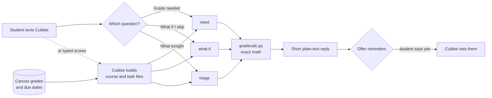
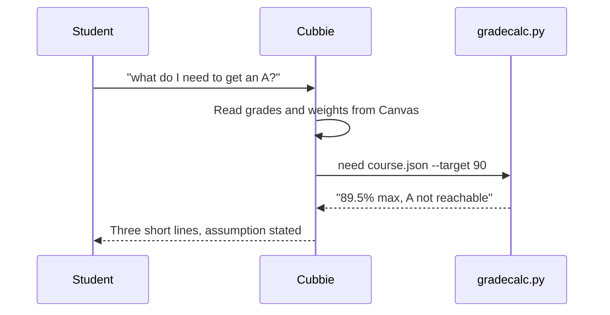

# Grade Triage

**A Cubbie Skill that tells you the grade you need and what to do tonight, using real math instead of guesses.**

Built for the Cubbie Hackathon (Track 1) at DevHacks S3, ASU.

[](LICENSE)


---

## The problem

Students guess at their grades. "Can I still get an A?" and "what should I do first tonight?" get answered by gut feel, and language models are unreliable at weighted grade arithmetic.

## What it does

Text Cubbie one of three questions and get a short, correct answer.

| You text | You get |
|---|---|
| "what do I need on my final to get an A?" | The exact average you need on the remaining work, or a clear "out of reach" |
| "what if I skip HW 5?" | Your best-case grade with and without it, and the points it costs |
| "my week is chaos, what do I do tonight?" | A ranked plan by grade points gained per hour, with an offer to set reminders |

### Example conversation (condensed from a live test on Cubbie)

> **You:** what do I need on my final to get an A? Homework is 30%, I got 90, 80, 95, with HW 4 and HW 5 still to do. Midterm is 30%, I got 72. Final is 40%.
>
> **Cubbie:** An A (90%) is out of reach. Even 100% on HW 4, HW 5 and the final gets you 89.5%.
>
> **You:** what if I skip HW 5?
>
> **Cubbie:** Skipping HW 5 as a zero drops your best case to 83.5%, 6 points below finishing it.
>
> **You:** my week is chaos, what do I do tonight? (4 hours)
>
> **Cubbie:** Quiz 6 first (1 hour, best payoff per hour). Then HW 4 (2.5 hours), submit before 11:59 PM. Plan the PHY 121 lab for tomorrow. Want me to set reminders?

## How it works



The key design choice: **Cubbie fetches the data, a tested script does the math, Cubbie writes the reply.** The model never does the arithmetic.



## Why it's built this way

- **Correct, not plausible.** Weighted grades, upcoming work and skipped work are computed in code, with unit tests.
- **Honest.** It says when a grade is out of reach and never invents a score. Skipping is shown as a cost in points, never as advice.
- **Consent first.** Nothing is scheduled or sent without the student's yes.
- **Private.** Grades stay in the student's account. Nothing is sent to any server.
- **Works without Canvas.** Students can type their weights and scores.
- **No dependencies.** Python 3 standard library only.

## Install on Cubbie

Text Cubbie this repository link, then reply **yes** to its summary:

```text
https://github.com/rahul0443/grade-triage
```

To update later, text `update grade-triage`.

## Run it yourself

```bash
python3 scripts/gradecalc.py need --sample
python3 scripts/gradecalc.py what-if --sample --skip "HW 5"
python3 scripts/gradecalc.py triage --sample --hours 4
python3 -m unittest discover -s tests
```

Sample output:

```text
CSE 310: 78.1% on 48% of the grade graded so far (C).
52.0% of the grade is still ahead.
Target 90% (A): not reachable, even 100% on everything left gives 89.5%.
Target 80% (B): average 81.7% on the remaining work.
```

## Repository layout

| Path | Purpose |
|---|---|
| [`SKILL.md`](SKILL.md) | Instructions Cubbie reads, including the reply style |
| [`scripts/gradecalc.py`](scripts/gradecalc.py) | The `need`, `what-if` and `triage` commands |
| [`assets/`](assets) | Sample course and task files used by `--sample` |
| [`tests/`](tests) | Unit tests for the math and the command line |

## Roadmap

- [ ] Read grading policies such as dropped lowest scores and extra credit
- [ ] Per-course cutoffs (for example A at 93) saved between chats
- [ ] Weekly Sunday-night plan, offered as an opt-in check-in
- [ ] Group-project mode that splits work by hours available
- [ ] Track 3 follow-up: a study-group assistant for Discord

## Team

Built by Rahul Muddhapuram and teammates at DevHacks S3, October 2026.

## License

[MIT](LICENSE)
